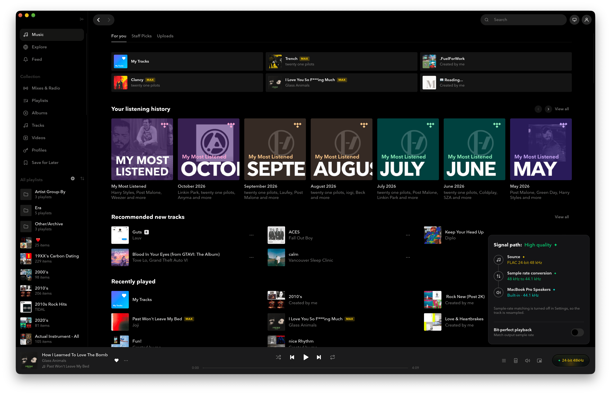
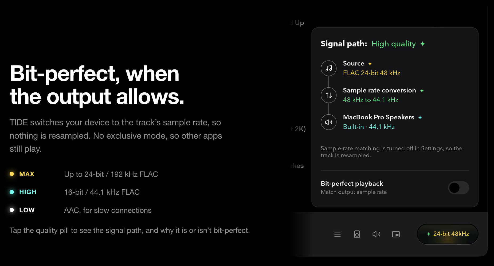
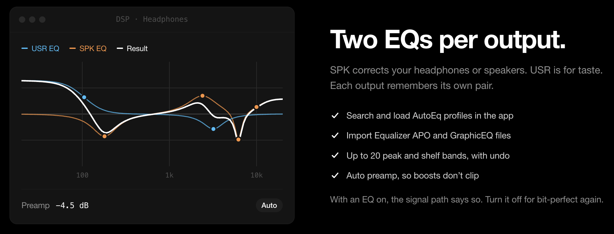

# TIDE

A native TIDAL desktop app for macOS, Linux and Windows, written in pure Rust
(Slint UI, Symphonia decoding, CoreAudio output on macOS). No Electron, no
WebView.

**[Website](https://gametl.github.io/tide-tidal-rust/)** ·
**[Download](https://github.com/GameTL/tide-tidal-rust/releases/latest)** ·
by [Tinapat Game Limsila](https://gametl.github.io/)

> TIDE is an unofficial, independent project. It is not affiliated with,
> endorsed by, or supported by TIDAL. You need your own TIDAL subscription.



## Install

```sh
curl -fsSL https://gametl.github.io/tide-tidal-rust/install.sh | sh
```

This installs the latest release to `/Applications/TIDE.app` and opens it
without a security prompt.

Or [download the dmg](https://github.com/GameTL/tide-tidal-rust/releases/latest).
TIDE isn't signed through Apple's paid Developer Program, so on first launch
click Done, then System Settings › Privacy & Security › **Open Anyway**.

### Linux (Ubuntu, Bazzite)

With [Homebrew](https://brew.sh), on x86-64 or Arm and Ubuntu 22.04 or later:

```sh
brew tap gametl/tide https://github.com/GameTL/tide-tidal-rust
brew install --cask tide
```

Start it with `tide` or from the app menu; `brew upgrade --cask tide` gets new
releases. Sound goes through the system's default ALSA device (PipeWire and
PulseAudio both provide one).

### Windows 10 and 11

[Download the installer](https://gametl.github.io/tide-tidal-rust/#download)
(`TIDE-<version>-windows-x64-setup.exe`) and run it. It installs for your user
without an admin prompt, adds TIDE to the Start menu, and uninstalls from
Settings › Apps. Windows on Arm runs it too. TIDE isn't code-signed, so
SmartScreen asks once: click **More info**, then **Run anyway**.

Sample-rate switching, the Liquid Glass player bar, media keys, music videos
and in-app updates are macOS-only for now.

## Features

- Bit-perfect playback: the output device switches to the track's sample
  rate, without exclusive mode, so other apps still play
- TIDAL MAX (up to 24-bit / 192 kHz FLAC), HIGH (16-bit / 44.1 kHz FLAC) and
  LOW (AAC) quality, with a signal path view that says whether playback is
  bit-perfect and why
- Two parametric EQs per output: SPK for headphone or speaker correction, USR
  for taste. AutoEq profile search, Equalizer APO and GraphicEQ import, up to
  20 bands, and automatic preamp
- Home feed, favourite tracks, playlists (with folders), mixes, artist pages,
  album details and catalog search
- Pin albums, playlists and profiles to the top of their library page. Pins
  stay on this computer and survive logging out
- Music videos: search, a Videos tab on each artist page, and a quality
  selector
- Seek, shuffle, repeat and gapless hand-over to the next track
- Synced lyrics in the full-screen now-playing view
- Local cache: library metadata, artwork and audio stay on disk, so played
  music starts without touching the network
- macOS media keys and Now Playing integration
- Interface zoom from 50% to 200%: **⌘=**, **⌘−**, and **⌘0** for 100%
- No telemetry, analytics or crash reports





## Run

```bash
cargo run --release -p tide-app
```

The first launch shows a login screen (TIDAL device-code flow in your browser).

To build a macOS app bundle with the TIDE icon and launch it from Finder or the Dock:

```bash
sh scripts/bundle-macos.sh
open target/release/TIDE.app
```

Pass `debug` to build `target/debug/TIDE.app`.

### Graphics memory

macOS defaults to the GPU-accelerated Skia/Metal renderer. To troubleshoot a
graphics issue, run with `TIDE_RENDERER=femtovg` for the previous OpenGL renderer,
or `TIDE_RENDERER=software` to render on the CPU instead.

The debug panel's **Graphics, driver & system** category is the process footprint
left after counted artwork, snapshots, malloc allocations and estimated window
buffers. It includes more than GPU textures; it is not a GPU-memory counter.

Compare renderers with the same offline, synthetic artwork workload (no login,
network requests or audio playback):

```bash
cargo run -p tide-app --example renderer_memory -- femtovg
cargo run -p tide-app --example renderer_memory -- skia
```

Append a step count (for example `skia 60`) for a longer run; each step takes
one second. Both runs use the real UI at the same window size, replace 48
synthetic covers and alternate between the artwork grid and settings.

### Desktop typography

For the desktop client's Nationale font, extract the `Fonts` folder from the
[TIDAL press kit](https://tidal.com/press) into `crates/tide-app/fonts`, or
set `TIDAL_FONT_DIR` to its absolute path before building. Builds without
these optional local files use the system font (Helvetica Neue on macOS,
Segoe UI on Windows, the fontconfig default on Linux).

## Layout

| Crate | Purpose |
| --- | --- |
| `crates/tide-api` | Login, session handling, TIDAL web API |
| `crates/tide-cache` | SQLite metadata store, audio and artwork caches |
| `crates/tide-audio` | Decoder and gapless CoreAudio output engine |
| `crates/tide-macos` | Media keys and Now Playing |
| `crates/tide-app` | The Slint application (`TIDE` binary) |

See [Goal.md](Goal.md) for the design goals, [Bit-Perfect.md](Bit-Perfect.md) for
sample-rate matching, and [SECURITY.md](SECURITY.md) for how login tokens and
local data are handled.

## Releasing

Merge a release PR (`staging` → `main`). That publishes a universal macOS dmg,
Linux x86_64 and arm64 tarballs and a Windows x64 installer, commits the Homebrew
cask (`Casks/tide.rb`) for the tarballs to `staging`, and refreshes the download
page.
